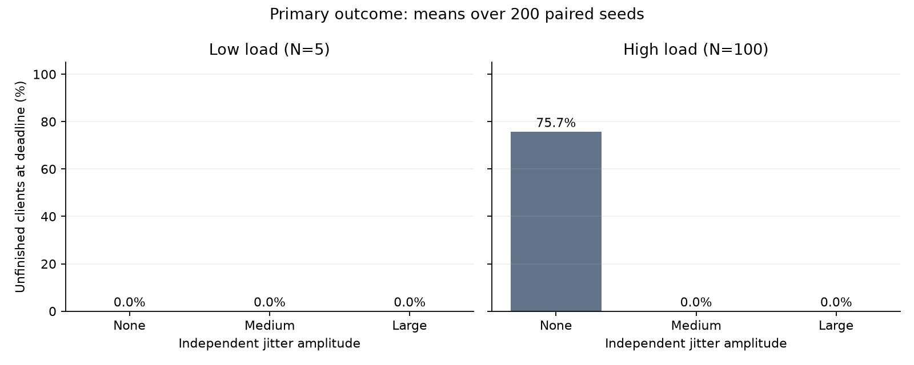
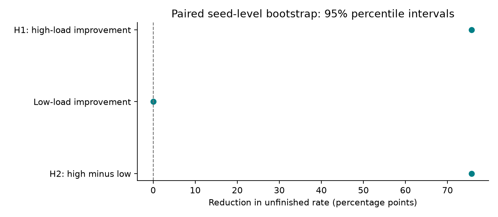
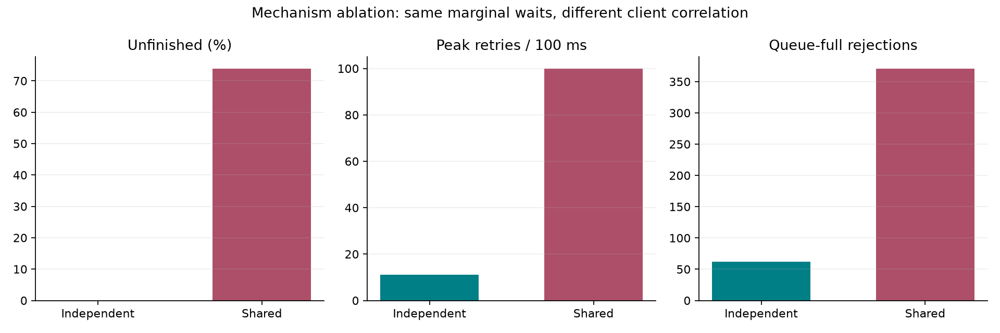
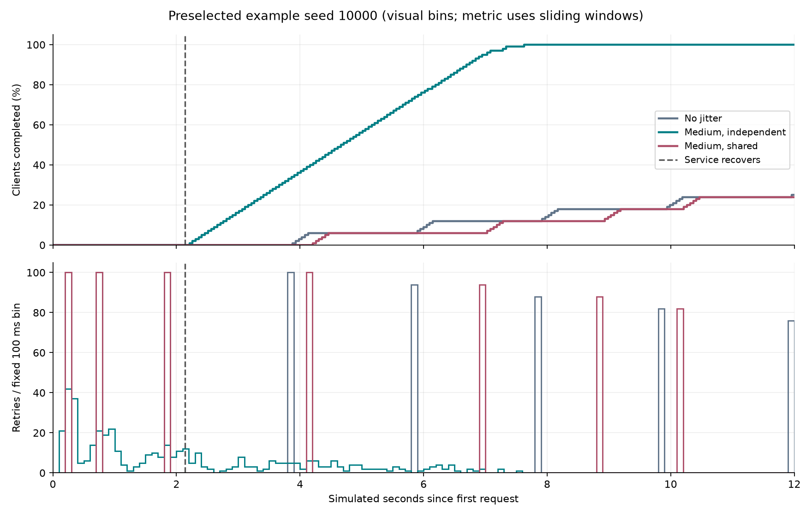

# 重试抖动幅度与客户端相关性对故障恢复的影响

《海洋数据挖掘技术》课程研究报告

**作者：周宇科　学号：22634015　报告日期：2026年11月12日**

**公开 GitHub 仓库（Public）：[Yuke-Zhou/-](https://github.com/Yuke-Zhou/-)**

**完整 AI 对话 Markdown：[逐条原始对话](https://github.com/Yuke-Zhou/-/blob/main/conversations/full_dialogue.md)**

## 1 研究问题与主要发现

**摘要**

针对海洋数据查询接口短暂故障后的同步重试问题，本文以客户端在共同截止时间前能否完成任务为首要目标，设计每轮期望等待相同的无抖动、中等独立抖动和大幅独立抖动策略，并以共享随机等待构造机制对照。实验使用离散事件模拟，在低、高两种负载下各进行200个种子的配对试验，合计1400轮、83,000个客户端任务与577,798次请求。高负载下，无抖动的平均未按期完成率为75.72%，中等与大幅独立抖动均为0%；中等相对无抖动改善75.72个百分点，配对95%区间为[75.45, 75.99]个百分点。共享抖动仍有73.94%的平均未完成率，支持“客户端之间去同步”是本模型中收益的重要机制。低负载全部按期完成，且两种独立抖动在主指标上打平，因而本实验不能确定普遍最优幅度，也不能证明真实服务零超时。

关键词：指数退避；随机抖动；重试风暴；有限队列；配对实验；截止时间

**选题来源**

课程课件《让重复迟到失败都变得无害》第9—10页介绍了指数退避与随机等待：客户端在失败后增加等待，并通过不同的随机等待分散同步请求[1]。本研究将这一小知识点放入一个容量和队列均受限的海温查询接口模型中。接口是只读操作，海温服务仅提供应用背景；实验不使用真实海温观测，也不评估海洋温度本身的变化。

研究者最初判断，在客户端少、服务容量充足时，确定性等待可能已经足够，并明确把“尽可能减少超时的客户端数量”作为优先目标。本文将其转化为低负载对照与截止时间指标。这里“未按期完成”还包括提前用尽重试次数的任务，不只包含网络请求超时。

## 2 已有方法与本项目的探索设计

随机退避不是本文提出的新算法。Brooker讨论了无随机性的指数退避仍可能形成请求簇，并比较了多种抖动方法[2]。Amazon Builders’ Library强调，重试会增加下游负载，随机等待可分散突发到达[3]。这些资料构成既有方法背景，不能被列作本文的新发现。

**控制平均等待而改变随机幅度**

直接扩大均匀随机等待的上限，会同时改变平均等待和方差，难以区分收益来自等待更久还是请求更分散。本文采用均值匹配的参数化定义。第j次失败后，基准等待为：

$$
b_{j} = min(0.25 × 2^{j-1}, 2) 秒，j = 1, 2, …
$$

$$
W_{i,j}(a) = b_{j} [1 + a(2U_{i,j} - 1)]，U_{i,j} ～ Uniform(0, 1)
$$

$$
E[W_{i,j}(a)] = b_{j}，Var[W_{i,j}(a)] = a^{2}b_{j}^{2} / 3
$$

由于2U-1的均值为0、方差为1/3，上式在相同失败次数下保持期望等待不变，只改变随机幅度。它不要求不同策略的实际总等待相同；成功时刻和尝试次数的变化本身就是结果。2秒是基准期望等待的上限，大幅抖动单次实际等待可达4秒。

| 策略 | 幅度a | 该轮等待分布 | 期望等待 |
| --- | --- | --- | --- |
| 无抖动 | 0 | 固定 b_j | b_j |
| 中等独立抖动 | 0.5 | Uniform(0.5b_j, 1.5b_j) | b_j |
| 大幅独立抖动 | 1 | Uniform(0, 2b_j) | b_j |

表1 均值匹配的策略定义

本实验的无抖动是确定性指数退避，并不是“每次固定1秒”；1秒只曾作为解释平均等待的例子。均值匹配的大幅抖动也不能与使用相同上限的标准Full Jitter直接混为一谈。

**预先指定的两个主假设**

H1：高负载下，中等独立抖动的平均未完成率低于无抖动。H2：中等独立抖动相对无抖动的改善，在高负载下大于低负载。大幅抖动为预先安排的探索对照，不在看到结果后替换主比较。

本项目的探索内容由三部分组成：隔离平均等待这一混杂因素；根据研究者偏好固定客户端截止时间指标；通过“独立随机—共享随机”对照检验客户端相关性。这是具体实验设计和机制分析的贡献，尚未确认为具有学术方法新颖性的新算法。

## 3 实验模型与评价口径

| 配置项 | 统一设置 |
| --- | --- |
| 负载 | 低负载5个客户端；高负载100个客户端；每个客户端一个任务 |
| 首次请求与恢复 | 所有客户端在t=0发起；恢复时刻R每轮采自Uniform(2,4)秒 |
| 服务能力 | 单工作器，每次成功服务0.05秒，处理能力约20个/秒 |
| 排队 | FIFO，最多5个等待请求，另有1个可正在处理 |
| 失败 | 服务未恢复或队列已满时拒绝；0.02秒后收到失败响应 |
| 已接纳请求 | 排队与处理期间不重试；完成后接收成功响应 |
| 任务预算 | 共同截止时间t=12秒；最多20次尝试，包含首次请求 |
| 客户端信息 | 只使用自己的失败轮次、响应和随机数，不读取未来恢复时刻 |
| 重复与规模 | 种子10000—10199；主试验1200轮，机制对照200轮 |
| 计时 | 整数纳秒；截止时刻完成计成功，截止时刻不再发新请求 |

表2 服务和客户端的共同配置

故障期间请求不会在服务端积压。客户端下一次尝试时刻等于失败响应到达时刻加等待时间。同一时刻先处理完成事件，再处理失败响应和新到达；同时到达的请求按预生成优先级处理。截止前仍在处理、排队、等待响应或重试，以及提前耗尽次数的任务，均计为未完成。

100个请求的理想处理时间为5秒，即使第4秒才恢复，理论上也可在第9秒完成，早于12秒截止。因此测试并非由物理容量不足强制导致失败。

$$
r = 截止前未成功的客户端数 / 本轮全部客户端数
$$

r为主指标。次指标包括全部请求次数、因队列满导致的拒绝次数、恢复后任意连续100毫秒内的重试峰值，以及达到全体客户端95%成功所需时间T95。峰值不含首次请求；T95在截止前未达成时记为“未达成”，不能只在成功客户端中计算P95。对于5个客户端，95%需向上取整为5个成功。

服务模型忽略拒绝请求消耗的CPU和网络资源，不设置单次请求超时，不模拟响应丢失或重复执行副作用。因此，指标反映的是有限队列模型中的任务可用性，而非真实HTTP服务的完整性能。

## 4 主实验结果

| 负载 | 策略 | 未完成率 | 请求量 | 重试峰值 | 平均T95 |
| --- | --- | --- | --- | --- | --- |
| 低 | 无抖动 | 0.00% | 25.60 | 5.00 | 4.322秒 |
| 低 | 中等独立 | 0.00% | 25.77 | 1.61 | 4.993秒 |
| 低 | 大幅独立 | 0.00% | 26.34 | 1.48 | 5.579秒 |
| 高 | 无抖动 | 75.72% | 842.88 | 100.00 | 未达成 |
| 高 | 中等独立 | 0.00% | 577.11 | 11.09 | 8.095秒 |
| 高 | 大幅独立 | 0.00% | 579.05 | 10.29 | 8.445秒 |

表3 主实验的描述性统计

各组均为200轮均值。请求量为每轮全部尝试次数；峰值单位为次/100毫秒。除高负载无抖动0/200轮达到T95外，其余各组均为200/200轮达到，因此表中有数值的T95没有额外删除未达成试验。



图1 不同负载和幅度下的未完成率。横轴None、Medium、Large分别对应无、中等和大幅独立抖动。纵轴为截止前未完成客户端的比例。

高负载下，中等独立抖动使未完成率从75.72%降至本次样本中的0%，每轮平均少75.72个未完成任务；请求量从842.88降至577.11，减少约31.53%。这是同时改善主指标和请求成本的结果，而非以更多超时换取更少请求。

低负载三组全部按期完成。确定性指数退避的平均T95为4.322秒，中等独立为4.993秒，大幅独立为5.579秒。因此本配置未观察到低负载的成功率收益，次指标上确定性等待也并不更差。该结果仍受12秒截止时间和当前恢复分布约束。

高负载中等和大幅独立抖动的主指标均为0%。大幅的峰值稍低，中等的平均T95稍短；这些属于描述性比较，未进行新的预设配对检验，不能据此声称某一幅度显著更优。

## 5 配对统计与假设判断

每个种子预生成环境、客户端优先级和按“客户端×失败次数”索引的随机数。不同幅度复用这些输入，环境与重试随机流分开。它避免因策略消耗随机数的顺序不同而改变服务恢复时刻，并使比较在同一环境下配对。

$$
d_{H,s} = r_{s}(0,H) - r_{s}(0.5,H)
$$

$$
I_{s} = d_{H,s} - [r_{s}(0,L) - r_{s}(0.5,L)]
$$

以200个独立种子为重采样单元，进行10000次配对百分位Bootstrap，得到平均差的95%区间。没有把同一轮客户端或577798次请求当成独立样本。5个百分点是协议预设的实际效果参考门槛，不是行业标准。区间描述固定模型与环境分布下的随机试验变化，不覆盖模型失真。

| 比较 | 平均改善 | 配对95%区间 | 本轮判断 |
| --- | --- | --- | --- |
| H1 高负载 | 75.72个百分点 | [75.45, 75.99] | 支持方向 |
| 低负载 | 0.00个百分点 | [0.00, 0.00] | 观察到打平 |
| H2 高减低 | 75.72个百分点 | [75.45, 75.99] | 支持方向 |

表4 预先指定的配对效应及置信区间



图2 配对效应与95%区间，横轴单位为百分点。区间较窄，在全量横轴下接近点状；准确数值以表4与analysis.json为准。

H1区间下限大于0，且改善幅度超过预设5个百分点参考门槛，故在本模型内支持高负载收益。H2同样得到正向结果，但低负载改善恒为0，使H2在本次数据上与H1数值完全相同。二者不能视为两份独立的现实证据。

低负载区间[0,0]只是该有限样本中所有组都成功形成的结果，不等价于证明策略在所有期限、恢复相位和容量下无差异。中等与大幅独立组观察到零失败，也不能被解释为真实未完成概率必为零。

## 6 共享随机等待的机制实验

若只比较随机与不随机，难以判断收益究竟来自单个客户端等待的波动，还是来自不同客户端不再同时请求。机制实验在高负载、a=0.5时，只改变随机数的客户端间关系：独立组使用U<sub>i,j</sub>，共享组在同一失败轮次使用同一个U<sub>j</sub>。两组单个客户端该轮的期望和边际分布相同，共享组则保留同步重试。

| 指标 | 中等独立 | 中等共享 | 共享减独立 |
| --- | --- | --- | --- |
| 未完成率 | 0.00% | 73.94% | 73.94个百分点 |
| 峰值 次/100毫秒 | 11.085 | 100.000 | 88.915 |
| 队列满拒绝 次/轮 | 61.995 | 371.010 | 309.015 |
| 全部请求 次/轮 | 577.110 | 812.240 | 235.130 |

表5 高负载下独立随机与共享随机的机制对照



图3 客户端独立随机与共享随机的对照。三个面板依次为未完成率、重试峰值和队列满拒绝次数，均为200轮均值。

共享减独立的未完成率差为73.94个百分点，95%区间为[73.36, 74.52]个百分点；峰值差区间为[88.710, 89.115]次/100毫秒；队列满拒绝差区间为[301.500, 316.450]次/轮。指标同时朝“独立随机更好”的方向变化。

该结果支持本模型中的机制链：独立等待降低到达相关性，减少短时请求集中与队列满拒绝，使工作器更连续地接纳请求，最终提高截止前完成率。共享组虽然每轮也有随机等待，仍明显差于独立组，说明“存在随机数”本身不足以解释收益。

这是对受控模型的机制证据，而非对所有分布式系统的因果定律。全体客户端同步启动、队列仅有5个等待位，都会放大同步到达的代价；真实网络已有的随机延迟或更大的队列可能减弱这种差异。

## 7 时间线与模型解析



图4 预先指定种子10000的高负载时间线。上图为累计完成比例，下图为不含首次请求的重试直方图，虚线表示服务恢复。直方图只用于展示，正式峰值采用滑动窗口。

图4使用配置中的首个种子，未按效果挑选“最好看”的案例。独立组在恢复后持续完成任务；无抖动和共享抖动的请求仍表现为成批到达，批次之间工作器可能空闲。所有统计判断仍基于全部200个种子，单条时间线只作解释。

为检查75.72%的高未完成率是否来自实现错误，可对确定性策略作解析复核。在20毫秒失败响应和预设退避下，请求时刻依次为0、0.27、0.79、1.81、3.83、5.85、7.87、9.89、11.91秒。一次同步到达最多接纳“1个处理中＋5个等待”的6个请求。

若服务在3.83秒时已恢复，前四个可用批次各完成6个，11.91秒批次仅首个于11.96秒完成，总计25个成功；若恢复晚于3.83秒，则少一个批次，共19个成功。日志中恰有176轮成功25个、24轮成功19个，故平均成功24.28个、未完成75.72个。这是事后的模型一致性解释，不作为额外独立试验。

## 8 探索贡献 适用边界与协作记录

**本项目完成的探索**

第一，依据研究者“优先减少超时客户端”的判断，以共同截止时间下的任务未完成率组织评价，使更少请求不能掩盖更多失败。第二，以均值匹配的分布控制随机幅度，减少平均等待不同导致的混杂。第三，以共享随机等待保持边际分布、改变客户端相关性，为去同步解释提供对照。第四，保存全部随机场景、逐请求与逐客户端日志，并通过解析边界和校验程序构成可追溯证据链。

上述内容属于本项目的受控实验设计、工程实现与机制验证。指数退避、随机抖动以及分散请求的思想均已有先例，参数化表达本身也未经过穷尽性查新。因此，本文不宣称提出新算法；如果课程将“原创创新”限定为算法层面的新方法，本轮结果还需要进一步扩展。

**影响外推与公平性的因素**

有限队列、同步首次请求、确定的50毫秒服务时间和固定失败响应，会强化请求成簇后的丢弃与空转；大队列、异步启动、可变服务时间、网络时延、响应丢失和拒绝请求资源开销均未覆盖。Google SRE也指出，拒绝请求仍会消耗资源，且固定每秒请求量不足以刻画所有服务的容量[4]。本实验的容量参数只是受控模型定义。

低负载主指标为零形成地板效应，不能证明字面上的“每次固定1秒最优”。高负载两种独立抖动也均为零，不能回答“幅度越大是否越好”。后续可另行登记更紧的截止时间、更大队列和异步启动等条件；本报告没有通过事后改参数追求新的显著结果。

**AI协作与研究者参与**

| 参与方 | 实际承担的内容 |
| --- | --- |
| 研究者 周宇科 | 选择随机重试主题；给出低负载直觉；明确优先减少超时客户端；确认开展工程实验与报告撰写。 |
| AI助手 | 检索官方资料；提出均值匹配和机制对照；编写模拟、测试、统计与绘图代码；通过工具在本地执行；依据输出起草报告。 |

表6 研究者和AI的实际分工

当前数值来自AI协作执行的工程输出，不能表述为研究者已经独立复现。本人独立复现与最终审核记录可在后续提交时补充。公开仓库和完整对话Markdown入口见首页；对话保留最初选题、机械臂方向的讨论、放弃原方向及后续转题过程。本节分工说明不能替代逐条原始对话。

## 9 结论与复现资料

对本次命题的回答是：在每轮期望等待匹配、100个客户端同步请求且服务队列较短的模型中，中等独立抖动相较确定性指数退避，显著降低了模拟任务的未按期完成率；低负载条件下没有观察到成功率收益，符合收益主要出现在竞争条件下的预期。共享随机等待未能消除同步到达，因而客户端之间是否独立随机，是本次结果中比“是否有随机数”更关键的设计因素。

“客户端少时固定等待可能足够”仅在本配置得到有限支持；“随机范围越大越好”没有获得主指标上的证据。中等与大幅独立组均为零未完成，不能选出普遍最优幅度。本研究最可靠的结论是一个有条件的机制判断及其复现证据，而非适用于所有真实服务的性能保证。

**运行环境与数据定位**

正式实验于2026年11月11日运行，报告整理于2026年11月12日。工程记录的环境为Windows 11、Python 3.12.14；核心模拟与统计仅依赖标准库。15项检查已在Python 3.7.12与3.12.14下通过。正式数据共1400轮、83000个任务、577798次请求，verify_run.py已通过数据与源码指纹校验及原始日志指标重算。

复现时进入experiments/retry_jitter目录，执行下列命令。使用新的输出目录，保留原始formal_v1。运行中simulated seconds为模型时间，manifest中约14.13秒为该次程序墙钟耗时，两者不能混淆。

```powershell
python -m unittest discover -s tests -v
python run_experiment.py --output results/my_run
python verify_run.py --run results/my_run
```

关键资料：EXPERIMENT_PLAN.md为事前协议；effective_config.json为实际配置；trials.csv与analysis.json为汇总与推断输入输出；attempts.csv.gz、clients.csv.gz、scenarios.jsonl.gz为原始证据；manifest.json保存源代码与数据SHA-256；figures_manifest.json保存图表输入输出指纹[5]。

**参考资料**

[1] 课程课件《第2讲 让重复迟到失败都变得无害》 幻灯片9—10。课程提供资料。

[2] Brooker M. Exponential Backoff And Jitter. AWS Architecture Blog, 2015-03-04. [官方原文](https://aws.amazon.com/blogs/architecture/exponential-backoff-and-jitter/)。检索日期2026-11-12。

[3] Amazon Builders’ Library. Timeouts retries and backoff with jitter, 2019-12-05. [官方原文](https://aws.amazon.com/builders-library/timeouts-retries-and-backoff-with-jitter/)。检索日期2026-11-12。

[4] Forero Cuervo A. Handling Overload. Site Reliability Engineering, Chapter 21. [官方在线章节](https://sre.google/sre-book/handling-overload/)。检索日期2026-11-12。

[5] 本项目实验工程 results/formal_v1。配置与结果以随报告提供的来源清单和工程manifest为准。原始模拟数据生成日期2026-11-11。
